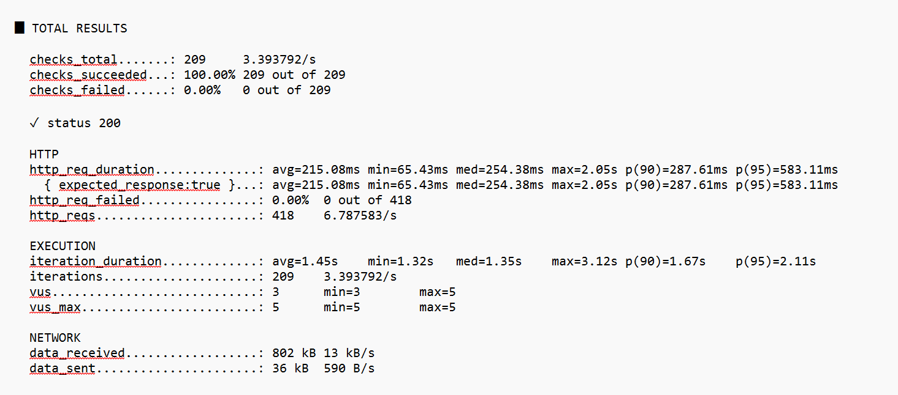
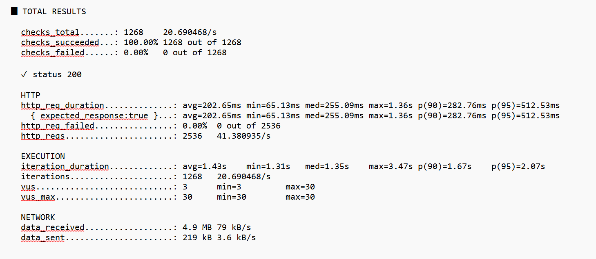
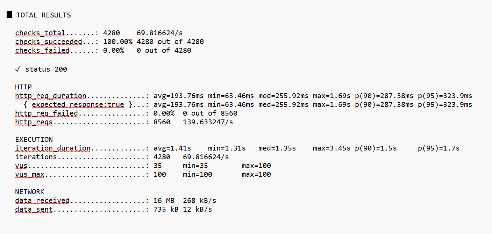

# Лаборатори №2: Гүйцэтгэлийн хэмжүүрийг k6-аар хэмжих

F.CSA313 — Программ хангамжийн чанарын баталгаа ба тест (2026)

## Ажлын орчин

```
k6.exe v2.4.0 (commit/dd9395906d, go1.26.11, windows/amd64)
```

- Үйлдлийн систем: Windows 11
- Тестийн бай: `https://test.k6.io` (зааврын албан ёсны дадлагын сайт)

## Алхам 2: Анхны тест — Baseline (5 VU, 30 секунд)

Скрипт: [`script.js`](script.js) · Бүтэн гаралт: [`results/baseline-30s.txt`](results/baseline-30s.txt)

| Хэмжүүр | Утга |
|---|---|
| http_req_duration — avg | 174.12 ms |
| http_req_duration — med | 188.34 ms |
| http_req_duration — p(90) | 271.96 ms |
| http_req_duration — p(95) | **276.44 ms** |
| http_req_duration — max | 287.33 ms |
| http_reqs (нийт) | 220 |
| Throughput (http_reqs/s) | 7.10 req/s |
| http_req_failed (error rate) | 0.00% (220-аас 0) |
| checks (status 200) | 100.00% (110-аас 110) |
| iterations | 110 (3.55 iter/s) |

**Миний baseline p95 = 276.44 ms.**

Тайлбар: iteration 110 байхад http_reqs 220 гарсан. Учир нь `https://test.k6.io` хүсэлтэд `302 Found` redirect буцаадаг тул k6 нэг iteration бүрд 2 HTTP хүсэлт (redirect + эцсийн хуудас) илгээж байна. Иймээс throughput-ийг http_reqs/s (7.10 req/s)-ээр тооцов.


## Алхам 3: Ачааллыг шатлан өсгөх (5 / 30 / 100 VU)

Түвшин бүрийг `script.js`-ээр тусад нь 1 минут ажиллуулсан (`k6 run --vus N --duration 1m script.js`).

| VU | avg | p90 | p95 | max | Throughput (req/s) | Нийт хүсэлт | Error rate | Файл |
|---|---|---|---|---|---|---|---|---|
| 5 | 215.08 ms | 287.61 ms | 583.11 ms | 2.05 s | 6.79 | 418 | 0.00% | [results/run-05vu.txt](results/run-05vu.txt) |
| 30 | 202.65 ms | 282.76 ms | 512.53 ms | 1.36 s | 41.38 | 2536 | 0.00% | [results/run-30vu.txt](results/run-30vu.txt) |
| 100 | 193.76 ms | 287.38 ms | 323.90 ms | 1.69 s | 139.63 | 8560 | 0.00% | [results/run-100vu.txt](results/run-100vu.txt) |

**Ажиглалт:**

- **Throughput** VU-тэй бараг шугаман хамааралтай өссөн: 5 → 30 → 100 VU үед 6.79 → 41.38 → 139.63 req/s (VU бүрд ойролцоогоор 1.4 req/s). Сервер 100 VU-д ч ханаагүй байна.
- **p90** гурван түвшинд бараг тогтмол (282–288 ms) байсан тул ихэнх хэрэглэгчийн туршлага ачааллаас үл хамааран өөрчлөгдөөгүй.
- **p95** ачаалал өсөхөд буурсан (583 → 513 → 324 ms). Энэ нь серверийн гүйцэтгэл сайжирсан гэсэн үг биш: 5 VU үед ердөө 418 хүсэлт байсан тул цөөн хэдэн удаан хүсэлт (max 2.05 s) p95-ыг өндөрсгөсөн. Хүсэлтийн тоо ихсэх тусам ганц нэг outlier-ийн нөлөө багасдаг.
- **Error rate** бүх түвшинд 0.00% байсан.
- Дүгнэвэл, test.k6.io нь CDN (CloudFront)-ийн ард байрладаг тул 100 VU хүртэлх ачаалал түүнийг ханахад хангалтгүй байсан. Лекцийн "10 хэрэглэгчтэй үед 2 с, 100 хэрэглэгчтэй үед 4 с" гэсэн latency-ийн муудал энэ бай дээр 100 VU-д хараахан илрээгүй. Хэрэглэгчийн туршлага тодорхой муудаж эхэлсэн цэг ажиглагдаагүй бөгөөд гол хэлбэлзэл нь сүлжээний санамсаргүй удаашралаас (p95/max) үүдсэн.





Stages туршилт ([`stages.js`](stages.js), [`results/run-stages.txt`](results/run-stages.txt)): …

## Алхам 4: Thresholds — SLO-г кодоор шалгах

**SLO:** p95 < 415 ms, error rate < 1%.

**Үндэслэл:** Алхам 2-т хэмжсэн baseline p95 = 276.44 ms. Гадаад сүлжээний хэлбэлзэл болон 30 VU-ийн ачааллыг тооцож baseline-ийг 1.5 дахин өсгөсөн (276.44 × 1.5 ≈ 415 ms) утгыг SLO болгон сонгосон.

| Тест | Threshold | Үр дүн | Файл |
|---|---|---|---|
| PASS | `p(95)<415`, `rate<0.01` | … | [results/thresholds-pass.txt](results/thresholds-pass.txt) |
| FAIL (санаатай хатуу) | `p(95)<50` | … | [results/thresholds-fail.txt](results/thresholds-fail.txt) |

Хатуу threshold (p95 < 50 ms) тавихад тест FAIL болдог нь CI pipeline дээрх quality gate SLO зөрчигдсөн үед хувилбарыг зогсоодог зарчимтай ижил.

## Алхам 5: Локал сервер (нэмэлт)

> ⏳ Хараахан хийгээгүй.

## Дүгнэлт

> ⏳ Бүх хэмжилт дууссаны дараа 8–10 өгүүлбэрээр бичнэ: ачаалал өсөхөд p95 ба throughput хэрхэн өөрчлөгдсөн, лекцийн аль ойлголт (latency p95/p99, throughput, error rate, availability) батлагдсан, SLO хангагдсан эсэх.

## Файлууд

- Скриптүүд: `script.js`
- k6-ийн бүтэн гаралт: [`results/`](results/) — `baseline-30s.txt`, `run-05vu.txt`, `run-30vu.txt`, `run-100vu.txt`
- Дэлгэцийн зургууд: [`screenshots/`](screenshots/)
